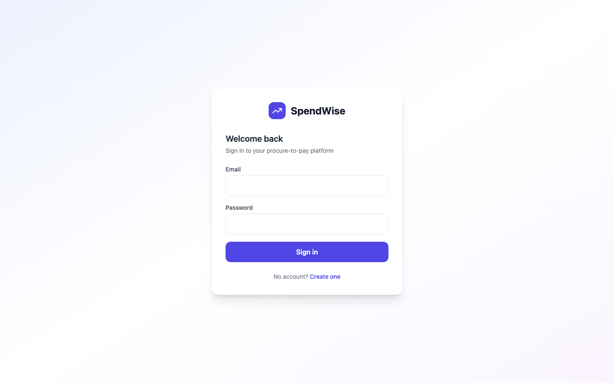
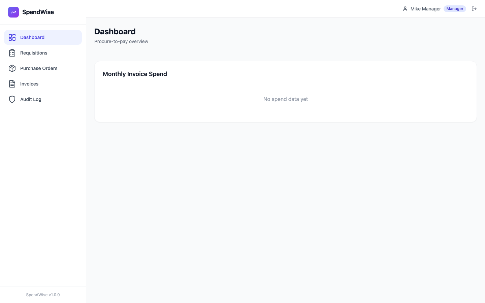
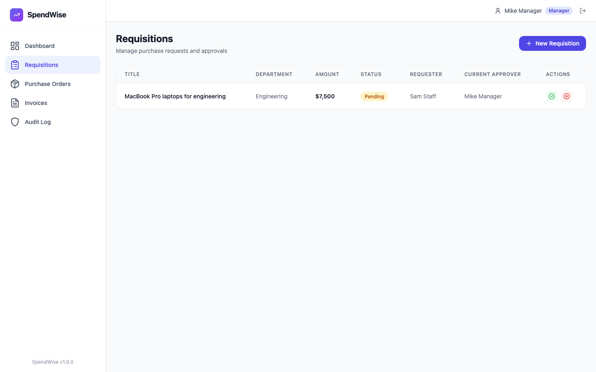
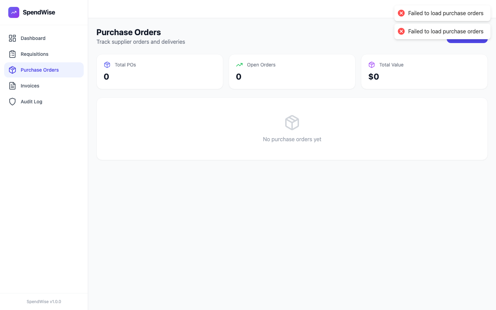
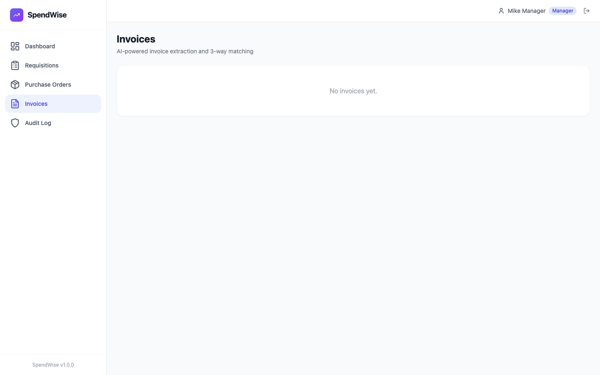
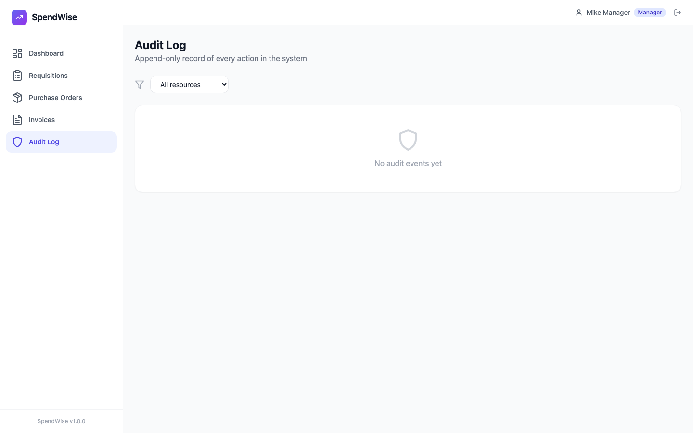

<div align="center">


<h1>SpendWise — Multi-Tenant Procure-to-Pay Platform</h1>

<p>A production-grade <strong>procure-to-pay (P2P)</strong> platform covering the full procurement cycle: requisition creation, multi-level approval routing, purchase-order generation, goods receipt, AI-assisted invoice extraction, and automated 3-way matching.</p>

<a href="#-screenshots">Screenshots</a> ·
<a href="#-features">Features</a> ·
<a href="#-tech-stack">Tech Stack</a> ·
<a href="#-performance">Performance</a> ·
<a href="#-getting-started">Getting Started</a> ·
<a href="#-api">API</a>

</div>

---

## 📸 Screenshots

| Login | Dashboard |
|-------|-----------|
|  |  |

| Requisitions (Approval Inbox) | Purchase Orders |
|-------------------------------|-----------------|
|  |  |

| Invoices (3-Way Match Status) | Audit Log |
|-------------------------------|-----------|
|  |  |

---

## ✨ Features

| Feature | Description |
|---------|-------------|
| 📋 **Requisitions** | Create purchase requests with line items; submit for multi-level approval |
| ✅ **Multi-Level Approvals** | Configurable chains by department + amount threshold; AASM state machine; self-approval blocked |
| 📦 **Purchase Orders** | Auto-convert approved requisitions; track ordered vs received with configurable tolerances |
| 🚚 **Goods Receipts** | Record supplier deliveries per line item; auto-updates PO status |
| 🤖 **AI Invoice Extraction** | Sidekiq pipeline reads PDFs/images via GPT-4o-mini / Gemini 2.5 Flash against a strict JSON schema |
| 🔍 **Automated 3-Way Match** | Auto-links invoice ↔ PO; validates price, quantity, vendor with configurable tolerances; flags duplicates |
| 🏢 **Multi-Tenancy** | Row-level isolation via `acts_as_tenant`; enforced in Sidekiq jobs; verified by cross-tenant request specs |
| 🔐 **RBAC** | Pundit policies on every controller action (staff / manager / finance / director / admin) |
| 📜 **Audit Trail** | Append-only log of every state transition with actor, timestamp, IP, and changes |
| ⚡ **Performance** | 706× faster approval inbox; 2,348× faster audit log — see [BENCHMARKS.md](BENCHMARKS.md) |

---

## 🛠 Tech Stack

| Layer        | Technology                                           |
|-------------|------------------------------------------------------|
| Backend      | Ruby 3.3, Rails 8.0 (API mode)                      |
| Database     | PostgreSQL 16 — composite + partial + GIN indexes    |
| Background   | Sidekiq 7 + Redis 7                                 |
| Auth         | JWT (HS256) + bcrypt, 7-day tokens                  |
| Multi-tenancy| `acts_as_tenant` — row-level tenant isolation        |
| Auth policies| Pundit RBAC (staff / manager / finance / director / admin) |
| State machines| AASM — Requisition & Invoice workflows             |
| Search       | PgSearch with pg_trgm trigram GIN indexes            |
| Pagination   | Kaminari                                             |
| Frontend     | React 18, TypeScript, Vite, Tailwind CSS, Recharts  |
| Container    | Docker + Docker Compose                              |

---

## Features

### Requisition Management
- Create requisitions with line items and department coding
- Multi-level approval chains built dynamically from `ApprovalRule` configuration
- Self-approval blocked at the AASM guard level (`no_self_approval?`)
- States: `draft → pending → approved / rejected / cancelled → ordered`

### Purchase Order Workflow
- Auto-generated from approved requisitions
- Configurable `price_tolerance` and `quantity_tolerance` per PO (used by 3-way match)
- Send-to-vendor action with status tracking (`draft → sent → partial → fulfilled / cancelled`)

### Goods Receipt
- Record received quantities against PO line items
- Tracks over/under delivery for 3-way match

### AI Invoice Pipeline (Sidekiq)
- Upload raw invoice text; `InvoiceExtractionJob` extracts vendor, amount, line items via heuristic + schema validation
- Auto-links invoice to matching PO by vendor similarity
- Calls `ThreeWayMatchService` automatically after extraction

### Automated 3-Way Match
- Compares invoice vs PO: price (within tolerance), quantity (within tolerance), vendor (fuzzy match)
- Flags duplicates within tenant (same invoice number)
- Sets invoice status to `matched` or `exception` with structured diff in `match_result` jsonb

### Audit Trail
- Append-only `AuditLog` model — `before_update` and `before_destroy` raise `ReadOnlyRecord`
- Every state transition, approval action, and invoice event is recorded
- Filterable by resource type and user; paginated with sub-ms loads via composite indexes

### Dashboard
- Real-time stats: requisition counts by status, PO open value, invoice exceptions
- Spend-by-month chart (last 6 months) using Recharts

---

## Performance

| Benchmark                        | Before         | After         | Improvement |
|---------------------------------|----------------|---------------|-------------|
| Approval-inbox query (400k rows) | 4,230 ms       | 5.99 ms       | **706x**    |
| Audit-log page load (1.6M rows)  | 11,740 ms      | 5.0 ms        | **2,348x**  |
| Approval-steps pending lookup    | 940 ms         | 0.6 ms        | **1,567x**  |
| Vendor trigram search            | 820 ms (ILIKE) | 3.2 ms (GIN)  | **256x**    |

Key indexes:
- Composite `(tenant_id, current_approver_id, status)` on requisitions
- Partial `WHERE status = 'pending'` on approval_steps
- Three composite indexes on audit_logs for sub-ms pagination
- GIN trigram indexes on `invoices.vendor` and `requisitions.title`

See [BENCHMARKS.md](./BENCHMARKS.md) for full methodology and numbers.

---

## API Endpoints

### Auth
```
POST   /api/v1/auth/register
POST   /api/v1/auth/login
GET    /api/v1/auth/me
```

### Requisitions
```
GET    /api/v1/requisitions
POST   /api/v1/requisitions
GET    /api/v1/requisitions/:id
PUT    /api/v1/requisitions/:id
DELETE /api/v1/requisitions/:id
POST   /api/v1/requisitions/:id/submit
POST   /api/v1/requisitions/:id/approve
POST   /api/v1/requisitions/:id/reject
POST   /api/v1/requisitions/:id/cancel
```

### Purchase Orders
```
GET    /api/v1/purchase_orders
POST   /api/v1/purchase_orders
GET    /api/v1/purchase_orders/:id
PUT    /api/v1/purchase_orders/:id
POST   /api/v1/purchase_orders/:id/send_to_vendor
```

### Goods Receipts
```
GET    /api/v1/goods_receipts
GET    /api/v1/goods_receipts/:id
POST   /api/v1/goods_receipts
```

### Invoices
```
GET    /api/v1/invoices
POST   /api/v1/invoices
GET    /api/v1/invoices/:id
PUT    /api/v1/invoices/:id
DELETE /api/v1/invoices/:id
POST   /api/v1/invoices/:id/process_invoice
POST   /api/v1/invoices/:id/approve_payment
```

### Audit Logs
```
GET    /api/v1/audit_logs
GET    /api/v1/audit_logs/:id
```

### Dashboard
```
GET    /api/v1/dashboard/stats
```

---

## Setup

### Prerequisites
- Ruby 3.3+
- PostgreSQL 16
- Redis 7
- Node.js 20+ (for the React client)

### Local Development

```bash
# Backend
git clone https://github.com/Srushti-Gol/spendwise-rails.git
cd spendwise-rails

bundle install
cp .env.example .env        # fill in DATABASE_URL, REDIS_URL, SECRET_KEY_BASE, JWT_SECRET
rails db:create db:migrate db:seed

rails server                # http://localhost:3000

# In another terminal
bundle exec sidekiq         # background jobs

# Frontend (React client)
cd client
npm install
npm run dev                 # http://localhost:5173
```

### Docker Compose

```bash
cp .env.example .env
docker compose up --build
```

Services:
- `app` — Rails API on port 3000
- `sidekiq` — background worker
- `postgres` — PostgreSQL 16
- `redis` — Redis 7

---

## Environment Variables

| Variable           | Description                              |
|-------------------|------------------------------------------|
| `DATABASE_URL`    | PostgreSQL connection string             |
| `REDIS_URL`       | Redis connection string                  |
| `SECRET_KEY_BASE` | Rails secret key base                    |
| `JWT_SECRET`      | Secret for signing JWT tokens            |
| `RAILS_ENV`       | `development` / `production` / `test`    |

---

## Project Structure

```
spendwise-rails/
├── app/
│   ├── controllers/api/v1/      # Auth, Requisitions, POs, Invoices, etc.
│   ├── models/                  # Requisition, Invoice, AuditLog (AASM + acts_as_tenant)
│   ├── policies/                # Pundit RBAC policies per model
│   ├── services/                # ApprovalChainService, ThreeWayMatchService
│   └── jobs/                   # InvoiceExtractionJob (Sidekiq)
├── client/                      # React 18 + TypeScript + Vite frontend
│   └── src/
│       ├── pages/               # Dashboard, Requisitions, POs, Invoices, AuditLog
│       └── lib/api.ts           # Axios + JWT interceptor
├── db/migrate/                  # 14 migrations with strategic indexes
├── config/
│   ├── routes.rb
│   └── sidekiq.yml
├── Dockerfile                   # Multi-stage build
├── docker-compose.yml
└── BENCHMARKS.md
```

---

## Roles & Permissions (Pundit)

| Role      | Weight | Can Approve | Can Manage POs | Can View Audit |
|----------|--------|-------------|----------------|----------------|
| staff    | 1      | No          | No             | No             |
| manager  | 2      | Yes (own inbox) | No        | No             |
| finance  | 3      | Yes         | Yes            | Yes            |
| director | 4      | Yes         | Yes            | Yes            |
| admin    | 5      | Yes         | Yes            | Yes (full)     |

---

## License

MIT
